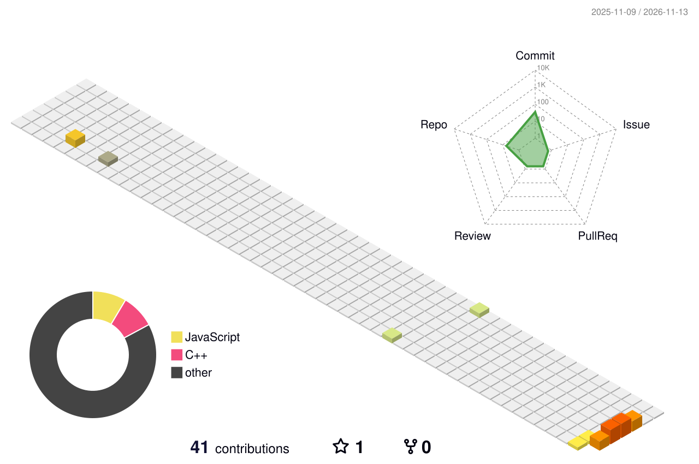

<div align="center">


<a href="https://git.io/typing-svg">
  
</a>

<br/>

<a href="https://github.com/Sanjanabanjare?tab=followers"></a>
<a href="https://github.com/Sanjanabanjare"></a>

<br/><br/>

<a href="https://www.linkedin.com/in/sanjana-banjare/"></a>
<a href="mailto:Sanjanabanjare2512@gmail.com"></a>
<a href="https://www.instagram.com/yuki_asukaaa/"></a>
<a href="https://github.com/Sanjanabanjare"></a>

</div>

<br/>

## 🌸 About Me

I'm a passionate software developer who loves transforming creative ideas into **interactive digital experiences**. I enjoy building immersive 3D websites, intelligent applications, and scalable solutions while exploring emerging technologies. ✨

```js
const sanjana = {
  role: ["Full-Stack Developer", "Software Engineer", "Creative Technologist"],
  loves: ["3D Web Development", "Data Analytics", "UI/UX Design"],
  funFact: "I love building websites that feel like stepping into another dimension 🌌",
  motto: "Dream it. Design it. Build it. Make it unforgettable. 🎀",
};
```

> 💬 *"Dream it. Design it. Build it. Make it unforgettable."*

---

## 🧊 My 3D Contribution Universe

<div align="center">



</div>

---

## 🎀 Tech Stack

<div align="center">

| | |
|:--|:--|
| **💻 Languages** |  |
| **🌷 Frontend** |  |
| **⚙️ Backend** |  |
| **🗄️ Databases** |  |
| **🛠️ Tools** |  |

</div>

---

## 🌱 Currently Learning

<div align="center">

| ✨ Focus Area | 🌸 What I'm Exploring |
|:--|:--|
| 🧊 **3D Web Development** | Three.js & React Three Fiber |
| ⚙️ **Backend Architecture** | REST API development |
| 🤖 **AI Integration** | Building intelligent applications |
| ⚛️ **Advanced React.js** | Interactive UI/UX |
| ☁️ **Cloud Computing** | AWS |

</div>

---

## 🦋 Featured Projects

<!-- TODO: Replace the project names, descriptions and links with your real projects -->

<table>
<tr>
<td width="50%">

### 🌸 [Project One](https://github.com/Sanjanabanjare/project-one)
An immersive 3D website built with Three.js. Replace this with your own description.
<br/>
`React` `Three.js` `CSS3`

</td>
<td width="50%">

### 🎀 [Project Two](https://github.com/Sanjanabanjare/project-two)
A full-stack app with a REST API. Replace this with your own description.
<br/>
`Node.js` `Express` `MongoDB`

</td>
</tr>
<tr>
<td width="50%">

### 🌷 [Project Three](https://github.com/Sanjanabanjare/project-three)
A data dashboard with insights. Replace this with your own description.
<br/>
`Python` `Power BI` `Excel`

</td>
<td width="50%">

### ✨ [Project Four](https://github.com/Sanjanabanjare/project-four)
A UI/UX design turned into a live product. Replace this with your own description.
<br/>
`Figma` `React` `MySQL`

</td>
</tr>
</table>

---

## 🐍 Snake Eating My Contributions

<div align="center">

<picture>
  <source media="(prefers-color-scheme: dark)" srcset="https://raw.githubusercontent.com/Sanjanabanjare/Sanjanabanjare/output/github-snake-dark.svg" />
  <source media="(prefers-color-scheme: light)" srcset="https://raw.githubusercontent.com/Sanjanabanjare/Sanjanabanjare/output/github-snake.svg" />
  
</picture>

</div>

---

## 💌 Let's Connect

<div align="center">

I'd love to collaborate on creative, immersive and intelligent projects. Say hello! 🌷

<a href="mailto:Sanjanabanjare2512@gmail.com"></a>

<br/><br/>

*Dream it. Design it. Build it. Make it unforgettable.* 🎀


</div>
